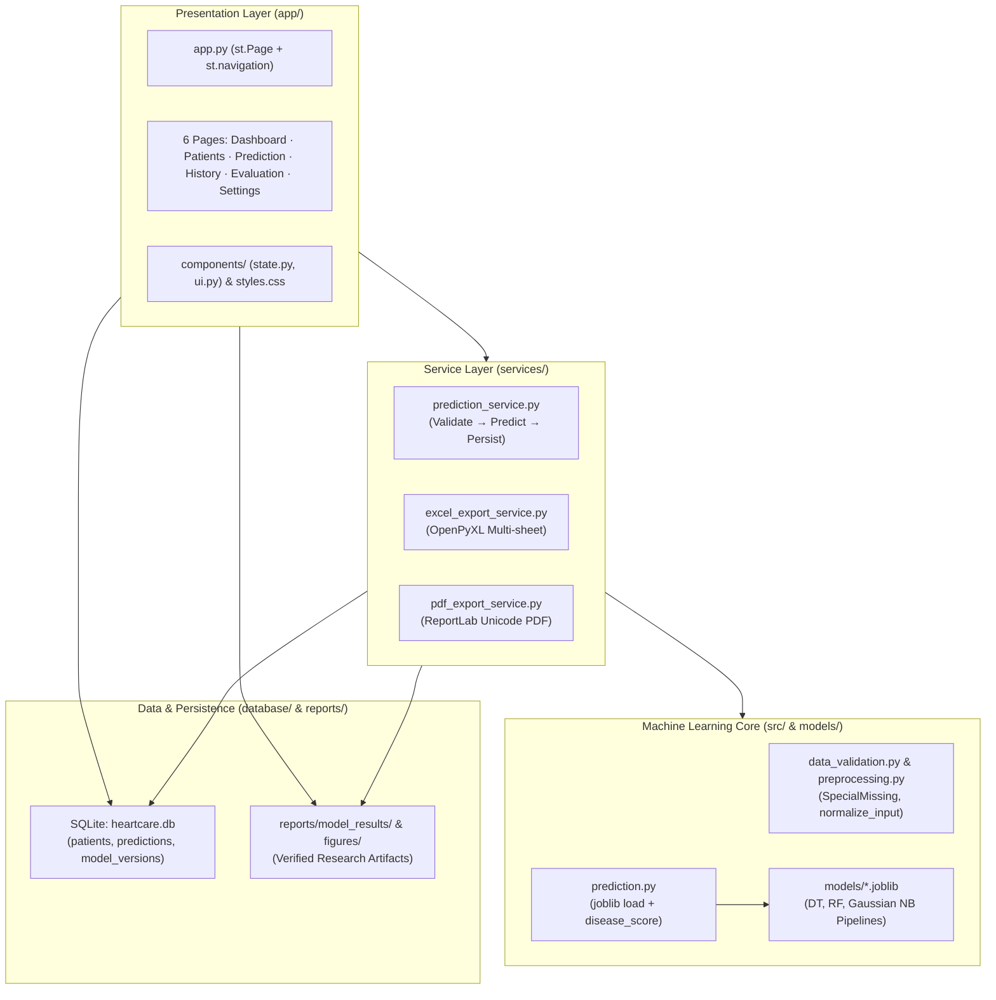

# 🫀 HeartCare AI — Hệ thống Quản lý Bệnh nhân & Hỗ trợ Phân loại Bệnh tim

**HeartCare AI** là hệ thống ứng dụng Machine Learning kết hợp quản lý hồ sơ bệnh nhân (**Streamlit + SQLite + Scikit-learn + Plotly + OpenPyXL + ReportLab**), được xây dựng theo kiến trúc phân lớp (layered architecture) từ kết quả nghiên cứu thực nghiệm trên ba mô hình **Decision Tree**, **Random Forest** và **Gaussian Naive Bayes**.

> **Lưu ý học thuật & y tế:** Ứng dụng chỉ phục vụ mục đích học tập và nghiên cứu, **không thay thế** việc thăm khám hoặc chẩn đoán của bác sĩ. Điểm đầu ra (`predict_proba`) của mô hình chưa được hiệu chỉnh thành xác suất mắc bệnh lâm sàng thực tế.

---

## ✨ Tính năng chính

- **Dashboard tổng quan (SQLite thời gian thực):** 6 thẻ KPI, biểu đồ Plotly tương tác (Donut phân bố nhãn, cột theo tháng, phân bố độ tuổi, thống kê theo mô hình) và bảng hoạt động gần đây.
- **Quản lý hồ sơ bệnh nhân (Full CRUD):** Thêm, sửa, xem chi tiết, xóa mềm có xác nhận (`is_active`), khôi phục hồ sơ, tìm kiếm đa trường, lọc theo giới tính/trạng thái/ngày tạo, sắp xếp và phân trang thực bằng SQLite (`10 / 20 / 50` bản ghi/trang).
- **Dự đoán bệnh tim (3 mô hình đã huấn luyện):** Nhập đủ 13 đặc trưng lâm sàng, chọn **Decision Tree**, **Random Forest** (mặc định theo F1 CV) hoặc **Gaussian Naive Bayes**, kiểm tra hợp lệ đầu vào và lưu kết quả bất biến kèm phiên bản mô hình (`model_version`) vào SQLite.
- **Lịch sử dự đoán bất biến:** Tra cứu lịch sử kèm bộ lọc, phân trang, xem lại trọn vẹn 13 chỉ số tại thời điểm dự đoán và liên kết nhanh về hồ sơ bệnh nhân.
- **Đánh giá mô hình trực quan:** Hiển thị đầy đủ Accuracy, Precision, Recall, F1-score, ROC-AUC, Confusion Matrix, Permutation Importance, Stratified 5-Fold CV và so sánh Baseline vs Tuned.
- **Xuất báo cáo chuyên nghiệp:**
  - **Excel (`.xlsx`):** Xuất danh sách bệnh nhân (toàn bộ / theo bộ lọc) và lịch sử dự đoán nhiều worksheet (kèm sheet 13 chỉ số chi tiết).
  - **PDF (`.pdf`):** Xuất phiếu tóm tắt hồ sơ & kết quả phân loại cho từng bệnh nhân (có kiểm tra chống xuất nhầm `patient_id`) và báo cáo PDF so sánh 3 mô hình kèm biểu đồ.

---

## 🏗️ System Architecture & Workflow

### 1. Kiến trúc phân lớp (Layered Architecture)



### 2. Luồng xử lý ML & Nghiệp vụ (End-to-End Workflow)

```mermaid
flowchart LR
    R["Raw Data\nheart.csv (1,025 rows)"] --> DEDUP["Deduplication\n302 unique rows\n(-723 duplicates)"]
    DEDUP --> NORM["Label Normalization\ntarget = 1 - raw_target\n(0: No Disease, 1: Disease)"]
    NORM --> SPLIT["Stratified Split 70/30\nTrain: 211 | Test: 91\n(random_state=42)"]
    SPLIT --> CV["GridSearchCV + 5-Fold CV\nFit Pipeline inside each fold\n(No Data Leakage)"]
    CV --> ART["Persisted Pipelines\nmodels/*.joblib\n(SHA-256 Verified)"]
    ART --> INF["HeartCare AI Web App\n13 Features → Validate → Predict"]
    INF --> DB["SQLite History\n+ Excel / PDF Reports"]
```



---

## 📋 Clinical Feature Dictionary (13 Đặc trưng & Biến mục tiêu)

> **Lưu ý mã hóa:** Bảng dưới đây phản ánh **đúng quy ước mã hóa thực tế** trong `data/raw/heart.csv` và `src/config.py` của dự án (đã đối chiếu qua `label_verification.json`). Chi tiết kiểm tra dữ liệu xem tại [data/README.md](data/README.md).

| Biến | Mô tả | Phạm vi / Mã giá trị | Ý nghĩa lâm sàng & Xử lý trong Pipeline |
| :--- | :--- | :--- | :--- |
| `age` | Tuổi bệnh nhân | `29 – 77` năm | Biến số (điền thiếu bằng trung vị; chuẩn hóa `StandardScaler` với Gaussian NB) |
| `sex` | Giới tính sinh học | `0 = Nữ`, `1 = Nam` | Biến nhị phân (điền thiếu bằng mode, giữ nguyên mã 0/1) |
| `cp` | Loại đau ngực | `0, 1, 2, 3` | `0`: Không triệu chứng, `1`: Đau thắt ngực không điển hình, `2`: Đau ngực không do thắt ngực, `3`: Đau thắt ngực điển hình (One-Hot) |
| `trestbps` | Huyết áp nghỉ | `94 – 200` mmHg | Huyết áp động mạch lúc nghỉ khi nhập viện (biến số) |
| `chol` | Cholesterol huyết thanh | `126 – 564` mg/dL | Tổng lượng cholesterol huyết thanh; giữ nguyên cực trị hợp lệ như `564` (biến số) |
| `fbs` | Đường huyết lúc đói > 120 mg/dL | `0 = ≤ 120`, `1 = > 120` | Chỉ dấu đường huyết lúc đói (biến nhị phân) |
| `restecg` | Điện tâm đồ lúc nghỉ | `0, 1, 2` | `0`: Phì đại thất trái, `1`: Bình thường, `2`: Bất thường sóng ST-T (One-Hot) |
| `thalach` | Nhịp tim tối đa đạt được | `71 – 202` nhịp/phút | Nhịp tim cực đại khi nghiệm pháp gắng sức (biến số) |
| `exang` | Đau thắt ngực khi gắng sức | `0 = Không`, `1 = Có` | Triệu chứng thiếu máu cơ tim khi vận động (biến nhị phân) |
| `oldpeak` | Độ chênh xuống đoạn ST | `0.0 – 6.2` | Mức chênh xuống ST do gắng sức so với lúc nghỉ (biến số) |
| `slope` | Độ dốc đoạn ST đỉnh gắng sức | `0, 1, 2` | `0`: Dốc xuống, `1`: Ngang, `2`: Dốc lên (One-Hot) |
| `ca` | Số mạch vành chính (soi huỳnh quang) | `0, 1, 2, 3` (`4 = Thiếu`) | `4` (4 bản ghi) được transformer `SpecialMissing` đổi thành `NaN` rồi điền mode + One-Hot |
| `thal` | Trạng thái tưới máu cơ tim (Thallium) | `1, 2, 3` (`0 = Thiếu`) | `0` (2 bản ghi) đổi thành `NaN`; `1`: Khiếm khuyết cố định, `2`: Bình thường, `3`: Khiếm khuyết hồi phục (One-Hot) |
| `target` | **Biến mục tiêu (Nhãn chuẩn hóa)** | `0, 1` | `0 = Không có bệnh`, `1 = Có bệnh` (`target = 1 - raw_target`) |

---

## 📊 Tóm tắt Kết quả Thực nghiệm (Tập Test độc lập, n = 91)

Quy tắc chọn mô hình được cố định trước khi đánh giá Test: **F1 trung bình cao nhất trên Stratified 5-Fold CV của tập Train (211 bản ghi)** → chọn **Random Forest** (`F1 CV = 0.831 ± 0.058`).

| Mô hình | F1 CV (Baseline → Tuned) | Accuracy (Test) | Precision (Test) | Recall (Test) | F1-score (Test) | ROC-AUC (Test) | AP (Test) |
| :--- | :---: | :---: | :---: | :---: | :---: | :---: | :---: |
| **Decision Tree** | `0.711 → 0.725` | `75.8%` | `77.8%` | `66.7%` | `0.718` | `0.743` | `0.709` |
| **Random Forest** *(Selected)* | `0.805 → 0.831` | `81.3%` | `80.5%` | **`78.6%`** | **`0.795`** | `0.885` | `0.879` |
| **Gaussian Naive Bayes** | `0.768 → 0.808` | `81.3%` | **`83.8%`** | `73.8%` | `0.785` | **`0.906`** | **`0.901`** |

> **Ghi nhận khoa học:** Dù Random Forest cải thiện F1 trên CV (`0.805 → 0.831`), trên tập Test độc lập 91 mẫu mô hình giảm nhẹ so với baseline (`Accuracy: 84.6% → 81.3%`, `F1: 0.825 → 0.795`). Toàn bộ kết quả được giữ nguyên trung thực và trực quan hóa tại `reports/figures/test_accuracy_f1_before_after.png`.

---

## 📁 Cấu trúc Thư mục Dự án

```text
HeartCare-AI/
├── app/
│   ├── app.py                        # Entrypoint Streamlit (st.Page + st.navigation)
│   ├── styles.css                    # Healthcare Management Dashboard CSS
│   ├── components/                   # Cached loaders (state.py) & UI components (ui.py)
│   └── pages/                        # dashboard, patients, patient_detail, prediction, history, evaluation, settings
├── data/
│   ├── README.md                     # Tài liệu chi tiết bộ dữ liệu & kiểm tra chất lượng
│   ├── raw/heart.csv                 # Dữ liệu gốc (1,025 dòng)
│   └── processed/                    # heart_clean.csv (302), train.csv (211), test.csv (91)
├── database/
│   ├── db.py                         # Schema SQLite (patients, predictions, model_versions)
│   ├── patient_repository.py         # CRUD, soft delete, search, filter, sort, SQL pagination
│   └── prediction_repository.py      # Lưu lịch sử bất biến & tổng hợp thống kê Dashboard
├── models/                           # 3 pipeline .joblib (SHA-256 verified, không huấn luyện lại)
├── reports/
│   ├── figures/                      # Biểu đồ đánh giá PNG (300 DPI) phục vụ báo cáo/slide
│   └── model_results/                # experiment.json, metrics.csv, cross_validation.csv, data_audit.json...
├── scripts/
│   ├── seed_demo_data.py             # Sinh 18 hồ sơ [DEMO] giả lập (chạy thủ công)
│   └── generate_report_figures.py    # Xuất 4 biểu đồ báo cáo (ROC, PR, CV F1, Test Before/After)
├── services/
│   ├── prediction_service.py         # Validation → Inference → SQLite persistence
│   ├── excel_export_service.py       # Xuất báo cáo Excel (.xlsx) với OpenPyXL
│   └── pdf_export_service.py         # Xuất báo cáo PDF tiếng Việt với ReportLab
├── src/                              # config, data_loader, data_validation, preprocessing, prediction, evaluate_models, train_models, utils
├── tests/                            # Parity tests, SQLite/CRUD tests, Excel/PDF & edge-case tests
├── requirements.txt
└── README.md
```

---

## 🚀 Hướng dẫn Cài đặt & Khởi chạy (Windows)

Khuyến nghị sử dụng **Python 3.13** (khớp chính xác `scikit-learn==1.9.1` đã huấn luyện mô hình):

### 1. Cài đặt thư viện
```powershell
py -3.13 -m pip install -r requirements.txt
```

### 2. Khởi tạo SQLite (tự động khi chạy web hoặc chạy thủ công)
```powershell
py -3.13 -c "from database.db import init_db, register_current_models; init_db(); register_current_models(); print('SQLite ready!')"
```

### 3. Sinh dữ liệu `[DEMO]` giả lập (tùy chọn)
Chỉ chạy khi cần 18 hồ sơ `[DEMO]` để kiểm thử CRUD, phân trang, biểu đồ Dashboard và xuất Excel/PDF:
```powershell
py -3.13 scripts/seed_demo_data.py
```

### 4. Khởi chạy website HeartCare AI
```powershell
py -3.13 -m streamlit run app/app.py
```

### 5. Xuất lại 4 biểu đồ báo cáo độ phân giải 300 DPI (tùy chọn)
```powershell
py -3.13 scripts/generate_report_figures.py
```

### 6. Chạy bộ kiểm thử tự động
```powershell
py -3.13 -m pytest -v
py -3.13 tests/test_models_parity.py
```

---

## 🔒 Giới hạn Bảo mật & Phạm vi Triển khai

- Phiên bản hiện tại **chưa tích hợp xác thực người dùng (Authentication) và phân quyền (RBAC)**, và chủ động không tạo màn hình đăng nhập giả.
- Ứng dụng **chỉ phù hợp chạy demo local với dữ liệu giả lập**, không triển khai lưu trữ hồ sơ y tế thật trên mạng công cộng.
- Toàn bộ tệp cơ sở dữ liệu (`database/*.db`, `*.sqlite*`) đã được chặn trong `.gitignore` để tránh đẩy dữ liệu bệnh nhân lên Git.
